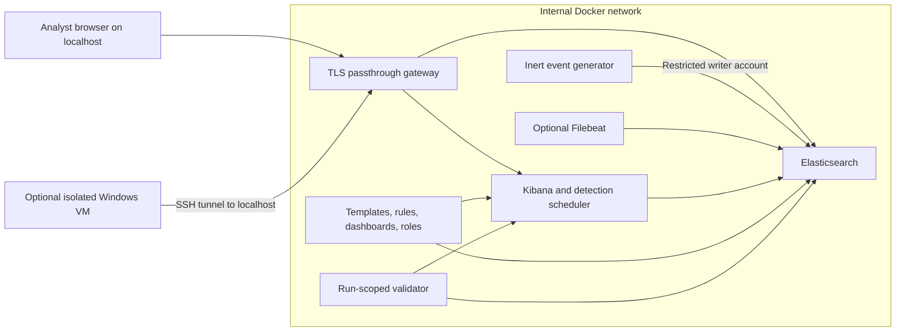
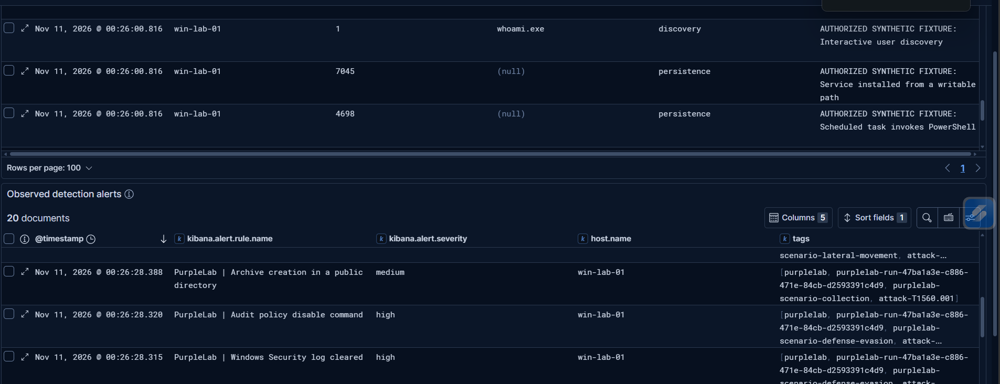
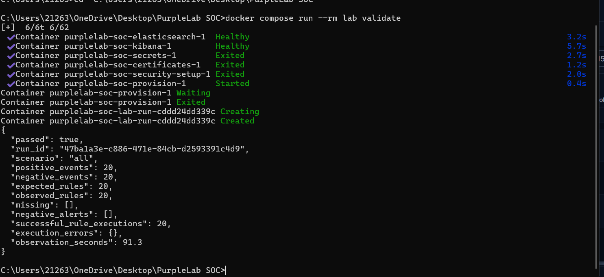

# PurpleLab-SOC

**Controlled Detection Validation Laboratory** — generate authorized Windows telemetry, investigate it in Elastic Security, and prove that scheduled detections fire.

[](https://github.com/TORNADO984/PurpleLab-SOC/actions/workflows/ci.yml)
[](LICENSE)


> **Authorized use only.** Use only systems you own or have explicit permission to test. The default lab generates inert JSON; it never executes attack commands, installs host agents, or changes host audit policy. Optional real tests belong in a separate disposable Windows VM.

## Quickstart

Requirements: Docker Engine/Desktop with Compose v2.24+ (Linux containers), at least **8 GB available RAM**, 4 CPU cores and 20 GB free disk. The first startup downloads images. The Python CLI inside the lab has no third-party runtime dependencies.

```sh
git clone https://github.com/TORNADO984/PurpleLab-SOC.git
cd PurpleLab-SOC
docker compose up -d
```

Wait for `provision` to finish successfully:

```sh
docker compose logs -f provision
docker compose ps -a
docker compose run --rm --no-deps lab credentials
```

Open **[https://localhost:5601](https://localhost:5601)**. Startup creates a private lab CA, TLS certificates, and unique passwords. The browser will initially distrust the lab certificate; see [certificate trust](docs/installation.md#certificate-trust). Sign in as `soc_analyst` for investigations or `detection_engineer` for rule work. Keep the printed credentials private.

```sh
# Generate one scenario; record its run ID
docker compose run --rm generator generate --scenario execution

# Require real alerts for all 20 positive fixtures and no alerts for 20 benign controls
docker compose run --rm lab validate
```

Validation normally takes 90–300 seconds. A nonzero exit means the run failed; the report lists missing rules, unwanted alerts and execution errors. In Kibana, open **Dashboards → PurpleLab • Event timeline** or **Security → Alerts**. Filter events with `purplelab.run_id: "<RUN_ID>"` and alerts with `tags: "purplelab-run-<RUN_ID>"`; use the last 15 minutes.

## What is included

- Elasticsearch and Kibana 9.5.6 with authentication, TLS, persistent volumes, healthchecks, resource limits and seven-day event retention.
- An internal backend network and a small localhost-only TLS passthrough gateway. No host networking, Docker socket mounting, or privileged containers.
- 20 original Sigma rules and their native Elastic equivalents, with ATT&CK mappings and positive/negative fixtures.
- Sysmon-like events 1, 3, 10, 11, 13 and 22; Windows Security events 4624, 4698 and 1102; System event 7045.
- Eight analyst playbooks with exact queries, evidence gaps, expected detections and false-positive discussion.
- Three imported Kibana dashboards: observed detection coverage, event timeline and scenario investigation.
- Automated templates, Windows field normalization, users, roles and detection imports.
- A restricted writer container, optional Filebeat ingestion, and a documented Windows VM/Sysmon/Winlogbeat path.
- Offline tests, live alert validation, an integration CI job, and an Atomic Red Team-compatible telemetry workflow.

This repository is a **controlled training lab**, not a production monitoring service. “Coverage” means selected simulated observations and measured rule outcomes; it does not mean complete ATT&CK coverage. See [limitations](docs/security.md).

## Architecture



The gateway also joins a bridge network for localhost port publishing; it forwards only to the two fixed backend services. See [the trust boundaries](docs/architecture.md).

## Investigation scenarios

1. [Suspicious PowerShell execution](scenarios/execution.md)
2. [Credential access indicators](scenarios/credential-access.md)
3. [Persistence mechanisms](scenarios/persistence.md)
4. [Reconnaissance timeline](scenarios/discovery.md)
5. [Remote access and lateral movement indicators](scenarios/lateral-movement.md)
6. [Lost Windows audit visibility](scenarios/defense-evasion.md)
7. [Lab DNS and unusual egress](scenarios/command-and-control.md)
8. [Local archive staging](scenarios/collection.md)

## Documentation

- [Installation and troubleshooting](docs/installation.md)
- [CLI, dashboards, Filebeat and evidence](docs/usage.md)
- [Architecture and data flow](docs/architecture.md)
- [Selected ATT&CK coverage matrix](docs/coverage.md)
- [Real Windows VM ingestion](docs/windows-vm.md)
- [Atomic Red Team workflow](docs/atomic-red-team.md)
- [Security boundaries and operational limitations](docs/security.md)
- [Contributing and testing](CONTRIBUTING.md)
- [Validation record](docs/validation.md)

## Screenshots

These screenshots are from a local synthetic validation run. The validator observed all 20 expected rules and no alerts on the 20 benign controls.

**Observed detection alerts**



**Validation result**



See [screenshot notes](docs/screenshots/README.md) for additional views to capture.

## Stop or reset

```sh
docker compose down                       # retain evidence and credentials
python scripts/cleanup.py --purge          # requires typing PURGE; destroys lab volumes
```

The project source and original detections are MIT licensed. Elastic, nginx, Python, Sysmon and Atomic Red Team have their own licenses; this repository does not relicense or redistribute those products.
