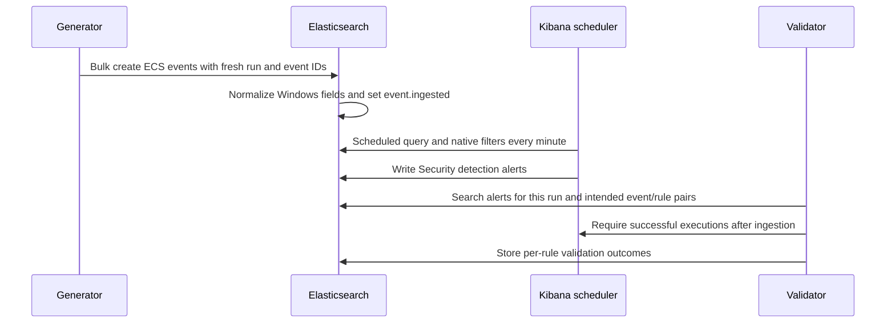

# Architecture and trust boundaries

PurpleLab runs single-node Elasticsearch and Kibana under Compose. A private CA issues separate backend certificates. Kibana uses `kibana_system`; its persistent encryption keys survive restart. Startup gates services in this order: generated secrets and certificates → healthy Elasticsearch → Kibana service password → healthy Kibana → roles/templates/pipeline/rules/dashboards. The gateway starts after Kibana becomes healthy.

## Networks

The `lab` network is `internal: true`. Elasticsearch, Kibana, generators, provisioners and Filebeat have no external bridge attachment. Only `gateway` joins `edge` and `lab`. It is an unprivileged nginx stream proxy with two fixed upstreams, no HTTP CONNECT endpoint, no shell API, and no secrets volume. It publishes **127.0.0.1:5601** and **127.0.0.1:9200**. TLS terminates at the backend service, not at nginx.

This avoids Docker versions that do not publish ports for containers attached only to an internal network. The gateway itself has bridge egress; backend containment is not a hostile-code sandbox. Never execute malware inside this Compose project. Docker/host administrators can read volumes and enter containers.

## Data and identity

- `purplelab-events-YYYY.MM.DD`: raw ECS events, one shard, no replicas, seven-day ILM deletion based on index age. Daily indices deliberately avoid rollover complexity.
- `.alerts-security.alerts-default`: genuine alerts owned by Elastic Security, never written by the synthetic generator.
- `purplelab-validation`: run-scoped outcomes. This small audit index has no automatic retention; export or purge intentionally.
- `event_writer`: create-only event documents and automatic index creation, no read or administrative access.
- `beats_writer`: equivalent ingestion rights plus cluster monitoring for Beats handshake.
- `soc_analyst`: read access to lab events, alerts, validation results and Kibana in the default space.
- `detection_engineer`: Kibana editing in the default space, lab event reads and the alert/list permissions needed for detection management. It is not an Elasticsearch superuser.
- `elastic`: bootstrap and lab administration. The transient `lab` service is administrative; `generator` only mounts writer secrets.

Rules are provisioned by the bootstrap identity, so their saved API keys reflect its permissions. Re-saving a rule as another user changes its execution authorization. Preserve the generating identity; validate after role changes. Do not use this lab's superuser bootstrap pattern for a multi-tenant production service.

## Reproducibility

`scripts/build_content.py` defines the educational cases and generates the catalog, Sigma/native rules, reference fixtures, playbooks, coverage matrix, pipeline and saved objects. UUIDs are stable; live event IDs and timestamps are fresh. Only the documented Sigma selection subset is supported. Native filters use case-insensitive wildcard matching for contains/endswith and exact terms for equality. KQL investigation examples may use case-sensitive keyword matching; the shipped fixtures use the shown spelling. Elastic stores custom exercise metadata in alert `_source` without indexing it; validation therefore queries indexed source event IDs and checks the run ID on returned documents. Indexed ECS tags support run filtering in the UI.

The unit tests inspect contracts and negative controls. Live validation is the integration gate: an index hit alone does not count as a detection. Dashboard counts describe observed synthetic activity, not enterprise-wide detection maturity.

References: [Elastic detections API](https://www.elastic.co/docs/api/doc/kibana/group/endpoint-security-detections-api), [saved object import](https://www.elastic.co/docs/api/doc/kibana/v8/operation/operation-importsavedobjectsdefault), [Docker networking](https://docs.docker.com/engine/network/).
